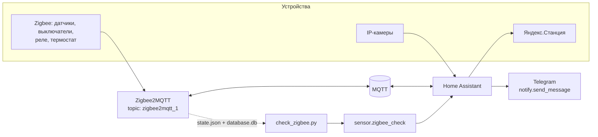

# 🏠 Home Assistant — конфигурация умной квартиры

> Автоматизации, шаблоны и архитектурные решения для реальной системы Home Assistant, работающей в квартире на HAOS.

Это **не бэкап**, а витрина логики: рабочие automations, скрипт диагностики Zigbee и подход к организации конфигурации. Полные снапшоты HAOS, `secrets.yaml` и runtime-данные хранятся отдельно и в этот репозиторий не попадают.

---

## 🎯 Зачем этот репозиторий

- Версионировать **логику автоматизаций**, а не состояние системы
- Фиксировать архитектурные решения (почему сделано так, а не иначе)
- Использовать Git как инструмент проектирования и код-ревью, а не как способ восстановления HAOS после сбоя
- Дать пример рабочей, а не «туториальной» конфигурации: с реальными edge-кейсами, защитой от ложных срабатываний и уведомлениями

## 🧩 Архитектура



- Устройства Zigbee работают через **Zigbee2MQTT** (префикс топиков `zigbee2mqtt_1`); часть автоматизаций слушает MQTT-топики напрямую (кнопки, датчики), часть — состояния сущностей HA.
- **Telegram** — основной канал уведомлений: текст через `notify.send_message` на `!secret telegram_notify_entity` (групповой чат). HTML-отчёт Zigbee и личные сообщения Мештастика идут через `telegram_bot.send_message`. Платформа `notify` с `platform: telegram` (`notify.me`) удалена в Home Assistant 2026.11. **Яндекс.Станция** — голосовые оповещения только для событий, требующих немедленной реакции (протечки, режим отъезда).
- **Мониторинг Zigbee** выполняется отдельно от HA-логики: `check_zigbee.py` читает файлы Zigbee2MQTT, результат публикуется как `command_line`-сенсор.

## ⚙️ Что реально автоматизировано

| Категория | Что делает |
|---|---|
| **Протечки** | 4 датчика (ванная, кухня, батареи в столовой и спальне). Ванная и кухня: уведомление в Telegram, **перекрытие воды** и голосовое оповещение. Батареи: уведомление в Telegram и голос, без перекрытия |
| **Диагностика Zigbee2MQTT** | `check_zigbee.py` каждые 5 минут проверяет свежесть `state.json` и возраст устройств. Возраст берётся из более свежей метки: `database.db` или `state.json`. Розетки и реле от сети — порог 2 часа, и если молчат все сразу, это отвал сети. Датчики протечки — 3 часа. Остальные — 24 часа. Telegram-уведомление приходит при **изменении набора проблемных устройств** (новые / вернувшиеся), плюс ежедневное напоминание в 10:00, пока проблема не устранена. Если сам сенсор недоступен больше часа — отдельный алерт, и пока он мёртв, напоминание в 10:00 повторяется |
| **Присутствие** | Уход/приход владельца (`device_tracker`) включает/выключает уведомления об открытии входной двери |
| **Режим «уехали надолго»** | Двойное нажатие кнопки 4 на выключателе в коридоре: включает `away_home`, снижает температуру на термостате батареи в спальне до 16 °C, выключает бойлер и кран холодной воды в ванной, озвучивает действие на Станции. Выключается вручную (`input_boolean.away_home`) |
| **Тёплый пол** | Реле управляется «демандом»: расписание окон нагрева × цикл загрузки (период и % включения настраиваются из UI) × сезонный выключатель × режим отъезда. Подробнее — ниже |
| **Освещение** | Zigbee-выключатели в спальне (кроватный светильник, основной свет с подсветкой, ночной режим) и коридоре (люстра, подсветка двери), кнопки у раковины и в туалете. Подсветка двери в коридоре включается по движению при освещённости ниже порога, если включён `coridor_motion` |
| **Вентиляция в ванной** | Автозапуск вентилятора на 5 минут при влажности выше 50 %, ручное переключение кнопкой в туалете |
| **Контроль и напоминания** | Автоотключение люстр в спальне и коридоре, если горят дольше 5 часов (с уведомлением); напоминание о поливе при низкой влажности почвы (дополнительно ежедневно в 10:00); сообщение на закате с температурой снаружи и внутри — косвенная проверка, что сервер и HA живы |
| **Meshtastic** | Личное сообщение на шлюз уходит в личный чат Telegram. Ответ на это уведомление возвращается в сеть на ту же ноду. Каналы и собственные исходящие не пересылаются |

### Тёплый пол: как устроено

Логика разделена на «что должно быть» и «как привести в соответствие»:

1. `binary_sensor.warm_floor_demand` (template) — чистая функция от времени и настроек. Он `on`, когда одновременно:
   - включён сезонный выключатель `input_boolean.warm_floor_enabled`;
   - режим отъезда `away_home` выключен;
   - сейчас идёт окно нагрева из `schedule.warm_floor` (по умолчанию 08:00–10:00 и 21:00–23:00 каждый день);
   - текущая фаза цикла укладывается в долю загрузки: `phase < period × duty / 100`, где `period` — `input_number.warm_floor_period_min`, `duty` — `input_number.warm_floor_duty_pct`.
2. Автоматизация `warm_floor_sync` приводит `switch.warm_floor_relay` в соответствие с демандом. Срабатывает по смене демандa, возвращению реле из `unavailable`, старту HA и каждые 5 минут (самолечение при расхождении). Действует только если оба состояния известны и расходятся.

Плюсы подхода: реле не зависит от «последнего события», после рестарта HA или потери связи состояние восстанавливается само.

`entity_id` деманда задан явно (`default_entity_id: binary_sensor.warm_floor_demand`). Без этого русское имя становится `binary_sensor.teplyi_pol_nuzhen_nagrev`, и синхронизатор смотрит не туда.

### Meshtastic: личные сообщения

Интеграция живёт на HAOS, в git её кода нет. В `automations.yaml` три автоматизации вокруг шлюза `meshtastic.gateway_a1ex_dm`:

1. Входящее личное сообщение уходит в личный чат (`!secret telegram_personal_notify_entity`), не в групповой. Свои исходящие отсекаются по длинному имени узла шлюза. Каналы сюда не входят: у них другой `entity_id`.
2. В сообщение кладётся метка ноды. Polling Telegram отдаёт у ответа только номер цитаты, без текста, поэтому пара «номер сообщения → нода» пишется в `input_text.meshtastic_reply_routes`. Хранятся последние 10 пар.
3. Ответ в личном чате на такое уведомление уходит `meshtastic.send_text` на эту ноду. Длиннее лимита прошивки не отправляется: до 100 русских букв или 200 латинских. Успех — реакция на самом ответе, без нового сообщения в чат.

### Сверка с сервером

17 ноября 2026, около 17:15 по местному времени. `configuration.yaml`, `automations.yaml`, `ui-lovelace.yaml`, `check_zigbee.py` и пустые `scripts.yaml` / `scenes.yaml` совпали с живым `/homeassistant`. `AGENTS.md` на сервере нет: это файл репозитория.

Плата — Raspberry Pi 4. HAOS **18.5** загружен со слота B, слот A хранит 18.4, оба помечены хорошими. Ядро `6.18.59-haos-raspi`. Диск 28.5 ГБ (занято 11, свободно 16.4). Core **2026.11.1**, к установке есть **2026.11.2**. Supervisor **2026.11.0**, канал stable, `healthy` и `supported`. NTP включён; флаг `dt_synchronized` в момент проверки был выключен.

Аддоны запущены, обновлений аддонов нет: Advanced SSH & Web Terminal 24.2.1, Terminal & SSH 10.6.0, Tailscale 0.30.7, Mosquitto 7.1.3, Zigbee2MQTT 2.14.3-1, File editor 6.3.1, Google Drive Backup 0.112.1. Get HACS установлен и остановлен.

Сущностей 2100. Все 26 автоматизаций из yaml включены. Ещё 29 `automation.*` в `unavailable` — старые записи реестра (прежний мониторинг Zigbee, старые сценарии тёплого пола и Мештастика), в yaml их нет. В момент сверки `sensor.zigbee_check` был `ok` (23 устройства), режим «уехали» включён, деманд тёплого пола и реле выключены.

## 📁 Структура репозитория

В репозиторий намеренно попадают только root-файлы `/config` (`*.yaml`, `*.py`, `README.md`) — см. `.gitignore`.

```
.
├── configuration.yaml    # точка входа: helpers, schedule, template-сенсоры, command_line, MQTT, notify, Lovelace
├── automations.yaml      # вся логика автоматизаций
├── ui-lovelace.yaml      # дашборд (YAML-режим): сервер, квартира, погода, камеры, климат
├── check_zigbee.py       # диагностика Zigbee2MQTT, вызывается command_line-сенсором
├── scripts.yaml          # HA-скрипты (пока пусто)
├── scenes.yaml           # сцены (пока пусто)
├── known_devices.yaml    # служебный файл device_tracker (пустой)
├── .gitignore            # «игнорировать всё, кроме root-конфигов и README»
├── README.md
└── AGENTS.md             # рабочая выжимка для правок
```

### Ключевые элементы `configuration.yaml`

- **`command_line` → `sensor.zigbee_check`** — запускает `check_zigbee.py` каждые 5 минут, состояние = `status`, остальное — атрибуты (`problem_key`, `offline_names`, `report` и др.).
- **Helpers** — `input_boolean` (`warm_floor_enabled`, `away_home`, `coridor_motion`, `notify_count`, `notify_door`), `input_number` для цикла тёплого пола, `schedule.warm_floor`, `input_text.meshtastic_reply_routes` для ответов в Мештастик.
- **Template-сенсоры** — время следующих рассвета и заката, деманд тёплого пола.
- **MQTT-сенсор** освещённости (`zigbee2mqtt_1/motion_sensor`) с `expire_after`, чтобы при пропаже данных он становился `unavailable`, а не «залипал».
- **Lovelace** — режим `yaml`, дашборд в `ui-lovelace.yaml`.
- **Frontend themes** подключаются из каталога `themes/`, который в репозиторий не входит.

## 🩺 Мониторинг Zigbee (`check_zigbee.py`)

Скрипт читает `state.json` и список устройств из `configuration.yaml` Zigbee2MQTT (понимает inline-секцию `devices` и вынесенный `devices.yaml`) и всегда печатает **ровно один JSON-объект** с кодом возврата 0 — сенсор HA никогда не остаётся с устаревшими данными.

| Статус | Значение |
|---|---|
| `ok` | все устройства выходили на связь в пределах своего порога |
| `offline` | есть устройства, молчащие дольше порога, без метки времени или с нечитаемой меткой. Порог сетевых розеток и реле — 2 часа, датчиков протечки — 3 часа, у остальных по умолчанию 24 часа |
| `stale` | сам `state.json` не обновлялся больше 30 минут — завис Z2M, проверка устройств приостановлена |
| `error` | проверка не отработала (нет файла, нет устройств, не включён `advanced.last_seen` и т. п.) |

Особенности:

- **Стабильный `problem_key`** — «отпечаток» набора проблемных устройств; по нему автоматизация шлёт уведомление ровно при изменении набора, без спама.
- **Определение массового сбоя** — если молчат все сетевые розетки и реле (их должно быть минимум два) либо одновременно ≥ max(3, 50 % устройств). В отчёте это помечено отдельно: сеть против пачки независимых отказов.
- **Возраст из `database.db`**, если эта метка новее `last_seen` в `state.json`. Кэш `state.json` на этой установке отстаёт.
- **Устойчивость к неатомарной записи** `state.json` — до трёх попыток чтения при битом JSON.
- **Индивидуальные пороги и исключения** — `MAX_AGE_OVERRIDES_H` и `IGNORE` в начале скрипта.
- **Готовый HTML-отчёт** для Telegram в атрибуте `report`.
- **Режим подбора порогов:** `python3 check_zigbee.py --ages` выводит таблицу возрастов `last_seen`.

Требование к Zigbee2MQTT: `advanced.last_seen: ISO_8601`.

## ❌ Что намеренно исключено

- `secrets.yaml`, пароли, токены, `chat_id`, `entity_id` Яндекс.Станции (всё через `!secret`)
- IP- и MAC-адреса устройств
- Видеопотоки и файлы камер
- Базы данных (`.db`), логи, кэш, runtime-файлы HAOS, каталог `themes/`

## 🔐 Секреты и приватность

Все чувствительные значения вынесены в `secrets.yaml` и в репозиторий не попадают (см. `!secret` в `configuration.yaml` и `automations.yaml`). Репозиторий безопасен для публичного просмотра, но конкретные `entity_id`, названия и сообщения показывают реальную топологию квартиры, поэтому это в первую очередь витрина подхода, а не шаблон для копирования один в один.

## 🧠 Принципы конфигурации

- **Git → идеи и логика, Backup → восстановление системы** — жёсткое разделение
- **Декларативное «что должно быть» + синхронизатор** (тёплый пол) вместо цепочек «включить/выключить по событию»
- **Защита от ложных срабатываний:** `for:` для датчиков, `expire_after` у MQTT-сенсора, условия на известное состояние (`unknown`/`unavailable`) в мониторинге
- **Защита от спама:** уведомления привязаны к изменению набора проблем, а не к каждому опросу; напоминания — раз в сутки
- **Самолечение:** периодическая синхронизация реле, повторная проверка при старте HA
- **Голос только для срочного** (протечки, режим отъезда); остальное — тихий Telegram

## 🔄 Как использовать этот репозиторий

Репозиторий не предназначен для прямого копирования — `entity_id`, MQTT-топики и `device_tracker` завязаны на конкретное железо.

1. Использовать как референс архитектуры и паттернов
2. Адаптировать `entity_id` и топики под своё оборудование
3. Завести собственный `secrets.yaml`
4. Проверить и протестировать через UI Home Assistant перед продакшеном

## 🚧 Статус

Отражает реальную работающую систему в текущий момент; структура и набор автоматизаций меняются по мере развития умного дома.

## 📌 TODO

- [x] Описать общую архитектуру системы (диаграмма интеграций)
- [ ] Задокументировать ключевые automations по отдельности
- [ ] Вынести повторяющиеся шаблоны (протечки, освещение по кнопке) в blueprints
- [ ] Привести `automations.yaml` к единому синтаксису (`triggers`/`actions` вместо `trigger`/`action`, `action:` вместо `service:`)
- [ ] Добавить упрощённый пример конфигурации для тех, кто хочет стартовать с нуля
